# PayFlow Pro

**A full-stack time-tracking and payroll-preparation portfolio project: an ASP.NET Core web app for the office and a React Native iPad kiosk for the field, both running on one C# REST API and one SQL Server database.**

> **Portfolio demo, not a production payroll system.** All people, job sites, hours and pay figures are fictional. The overtime rule (weekly hours above 40 paid at 1.5×) is a simple demonstration rule. It is **not** payroll or wage-and-hour compliance and handles no taxes, deductions or payslips.
> The full application source code is kept private. This repository contains documentation, screenshots and demo videos only. Source code can be reviewed in a walkthrough on request.

## Watch the demos

Both videos are hosted as assets of the [v1.0.0 release](https://github.com/gssp51/PayFlowPro-Portfolio/releases/tag/v1.0.0) (click a thumbnail to open the video; GitHub lets you play or download it).

### 1. Complete live demo (Web + iPad), about 13 min
Shows the **working application**: signing in, the office web app (employees, time entries, timesheets, approvals, payroll, reports) and the React Native iPad kiosk (job site and shift setup, Employee ID clock-in, clock-out with questions and signature), with live interactions and my own narration.

[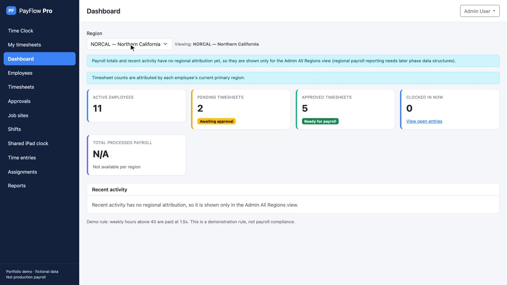](https://github.com/gssp51/PayFlowPro-Portfolio/releases/download/v1.0.0/PayFlowPro-Complete-Live-Demo-Final-iPadFrame.mp4)

**[PayFlow Pro: Complete Live Demo (Web + iPad)](https://github.com/gssp51/PayFlowPro-Portfolio/releases/download/v1.0.0/PayFlowPro-Complete-Live-Demo-Final-iPadFrame.mp4)**

### 2. Technical code walkthrough, about 4 min
Shows the **actual source code** in VS Code: the C# Web API architecture and dependency injection, Entity Framework Core and SQL Server, the React Native kiosk code, the payroll and approval business logic, and the automated test suites running live (366 .NET and 48 Jest tests passing), with my own narration.

[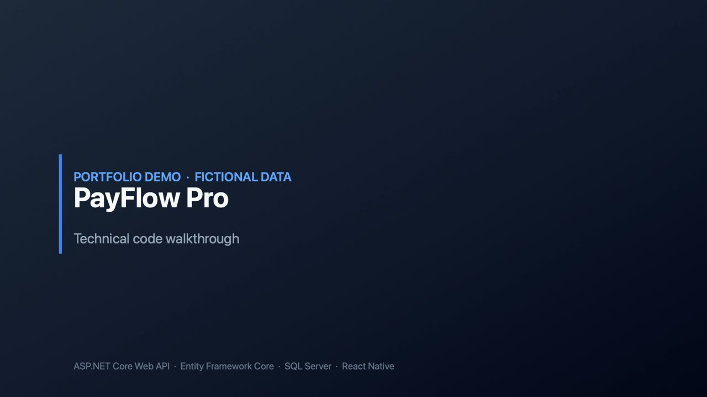](https://github.com/gssp51/PayFlowPro-Portfolio/releases/download/v1.0.0/PayFlowPro-Technical-Code-Walkthrough-Final.mp4)

**[PayFlow Pro: Technical Code Walkthrough](https://github.com/gssp51/PayFlowPro-Portfolio/releases/download/v1.0.0/PayFlowPro-Technical-Code-Walkthrough-Final.mp4)**

## What it does

- **Office web app (ASP.NET Core MVC):** dashboard, employees, time entries, timesheets, approvals, payroll, reports, job sites, shifts and assignments, scoped by role and region.
- **Field iPad kiosk (React Native, JavaScript):** a supervisor sets up the job site and shift; workers clock in and out with an Employee ID, answer the injury and meal-break questions, and sign on screen.
- **One backend for both:** the web app and the iPad app use the same REST API and database. Payroll and time rules exist only in the C# backend.
- **Timesheet workflow:** draft, then supervisor approval, then locked, then payroll processing. Only an HR Admin can reopen a locked week, and a reason is required.

Details: [docs/features.md](docs/features.md)

## Office and Field timekeeping

| | Office (web) | Field (iPad kiosk) |
|---|---|---|
| Who | Office employees | Field workers on a shared iPad |
| Identity | Own username and password | Employee ID only; the iPad is authorized by a supervisor |
| Clocking | Personal clock, region time zone, no GPS or job site | Job site, selected shift, geofence |
| Approval | HR Admin | Site supervisor |

Payroll and timesheet approvals run through one workflow: draft, approved and locked, payroll processed.

## Technology

| Area | Technology |
|---|---|
| Backend | C#, ASP.NET Core Web API (.NET 10), controllers, dependency injection |
| Web | ASP.NET Core MVC (Razor, Bootstrap) |
| Data | Entity Framework Core 10, SQL Server, migrations |
| Mobile | React Native CLI, JavaScript (iPad) |
| Security | JWT bearer authentication, ASP.NET Core Identity, role-based authorization policies, device tokens |
| Testing | xUnit (.NET), Jest (React Native) |

## Architecture and security

```
 Office staff / HR Admin / supervisors          Field workers on a shared iPad
   ASP.NET Core MVC (web app)                     React Native (JavaScript)
                 \                                  /
                  \     HTTPS / JSON (JWT | device token)
                   v                                v
                 ASP.NET Core REST API (controllers, policies, rules)
                  |  PayFlowPro.Core  (entities, PayrollCalculator)
                  |  PayFlowPro.Infrastructure  (EF Core, Identity)
                  v
              SQL Server
```

- Neither front end connects to the database; everything goes through the API.
- Role- and region-based authorization is enforced on the server (Employee, Supervisor, Superintendent, Admin, VP).
- The iPad is authorized by a supervisor; PINs and device tokens are stored hashed.
- Locked timesheets cannot be edited from any client; changes are audited.
- Secrets (connection string, signing key, demo password) are kept in user secrets, never in the repository.

Details: [docs/architecture.md](docs/architecture.md)

## Automated testing

Last run on 22 Nov 2026 and shown live in the technical walkthrough video: **366 .NET tests passed** and **48 React Native Jest tests passed**.


| Suite | Result |
|---|---|
| .NET (xUnit) | **366 passed**, 0 failed |
| React Native (Jest) | **48 passed** in 5 suites |

Details: [docs/testing.md](docs/testing.md)

## Screenshots

### Web app

| | |
|---|---|
| 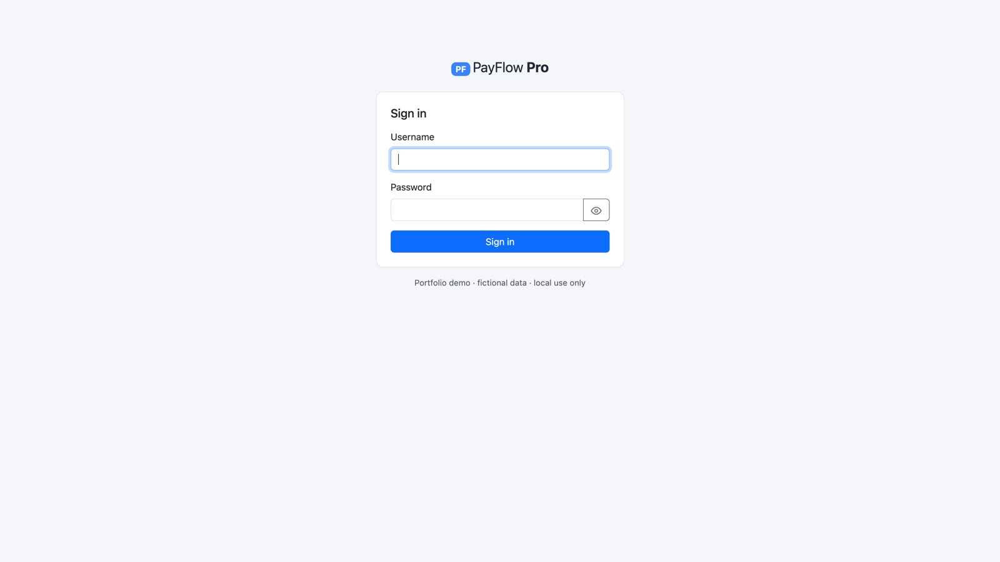 | 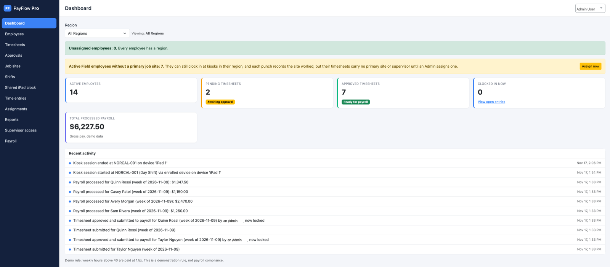 |
| 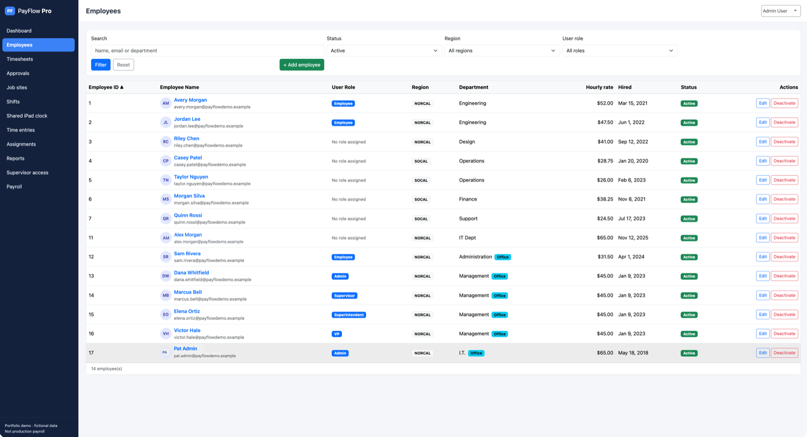 | 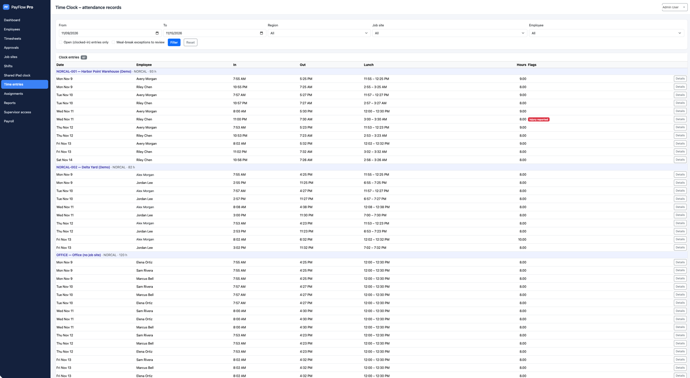 |
| 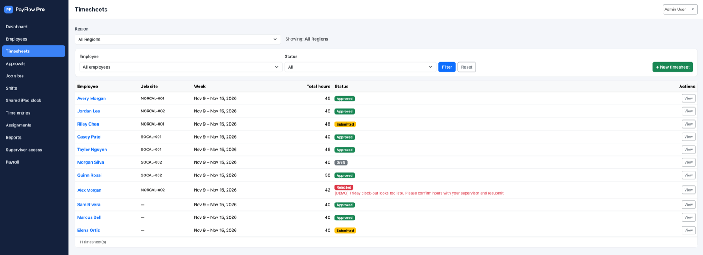 | 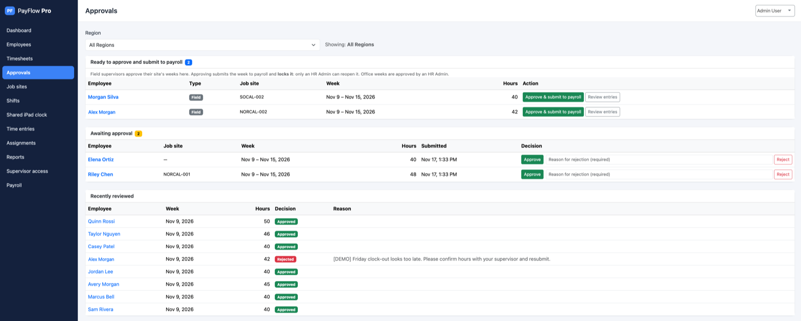 |
| 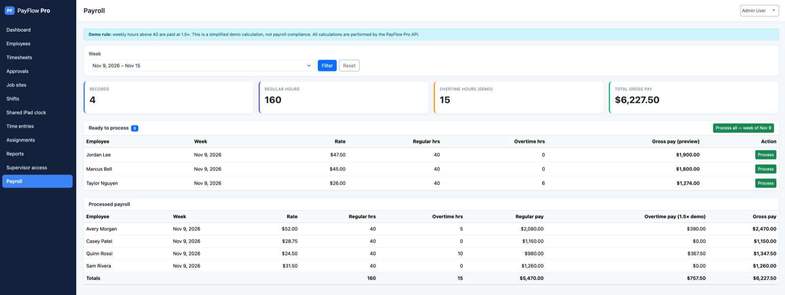 | 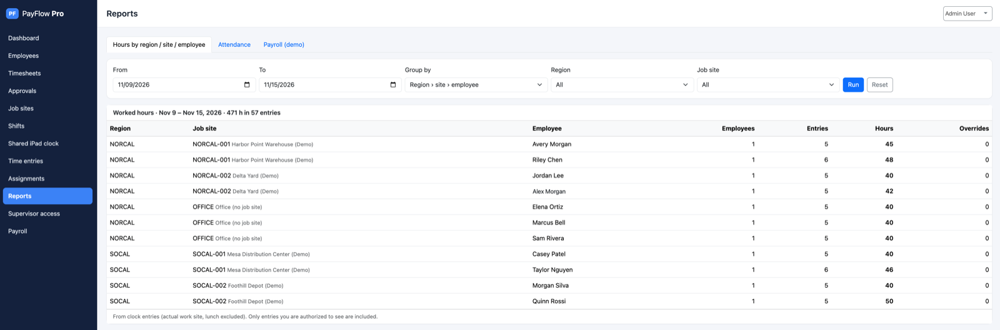 |
| 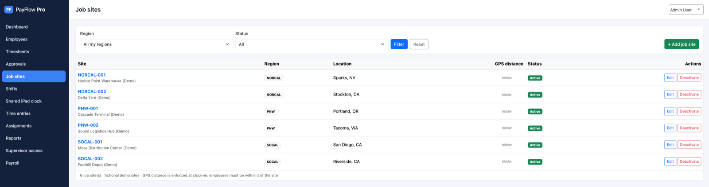 | |

### iPad kiosk

| Setup | Keypad | Clock in | Clock out | Signature |
|---|---|---|---|---|
| 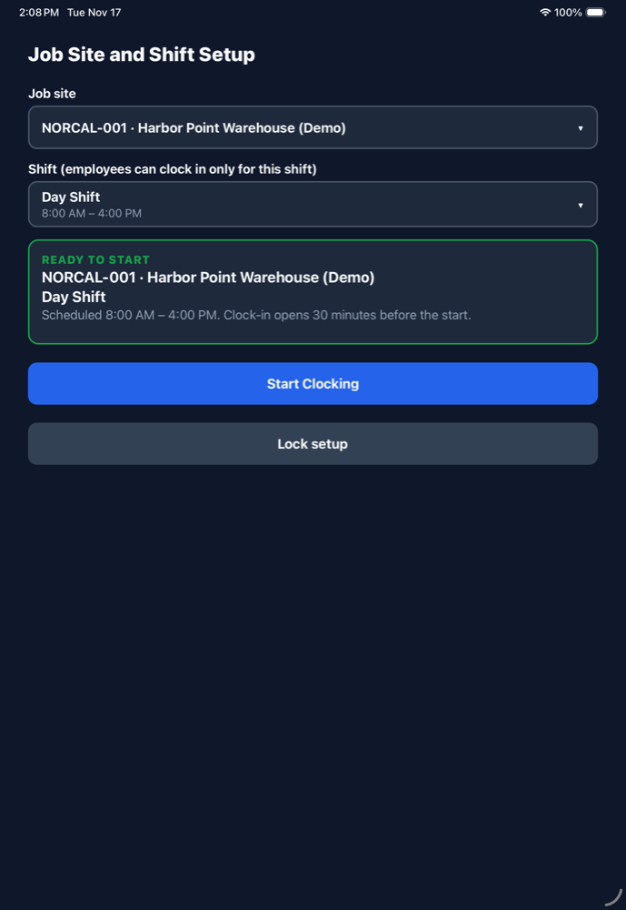 | 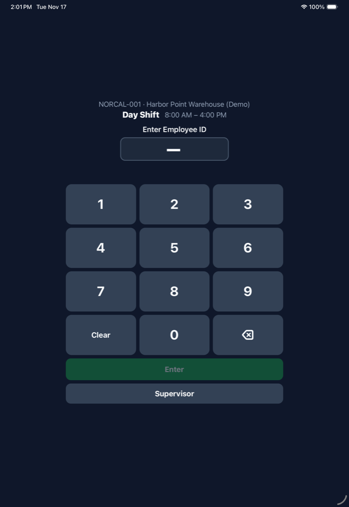 | 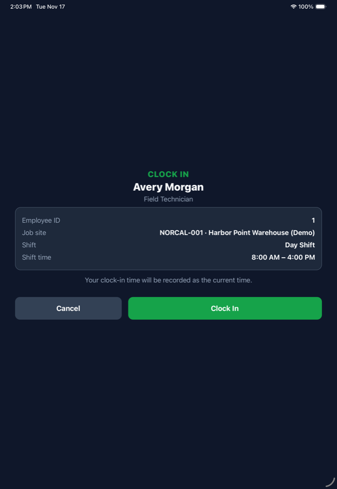 | 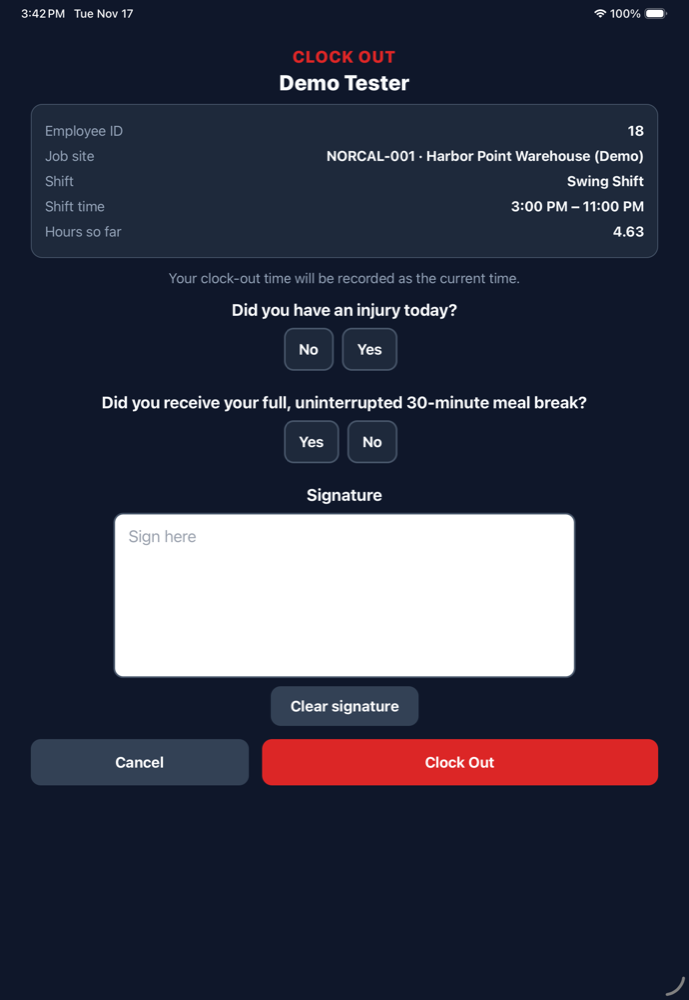 | 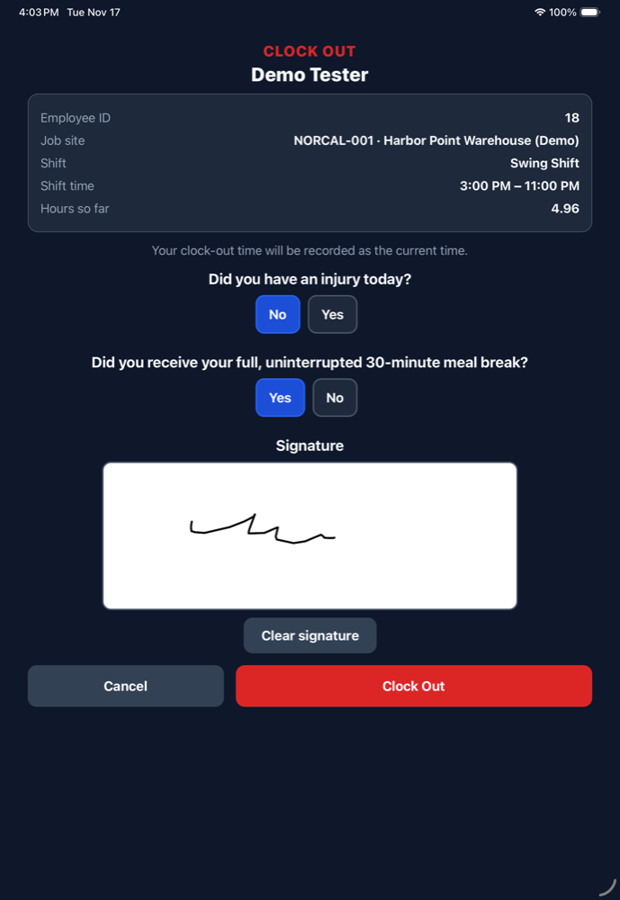 |

## Known limitations

No payroll compliance, taxes or deductions. A week that payroll has processed cannot be reopened, and payroll adjustments are not built. Office clock-out has no signature or injury question. The demo runs locally.

## About

Built as a portfolio project to show ASP.NET Core API design, EF Core with SQL Server, role-based security, a React Native kiosk and automated testing. Questions or a code walkthrough: contact me through my GitHub profile.
